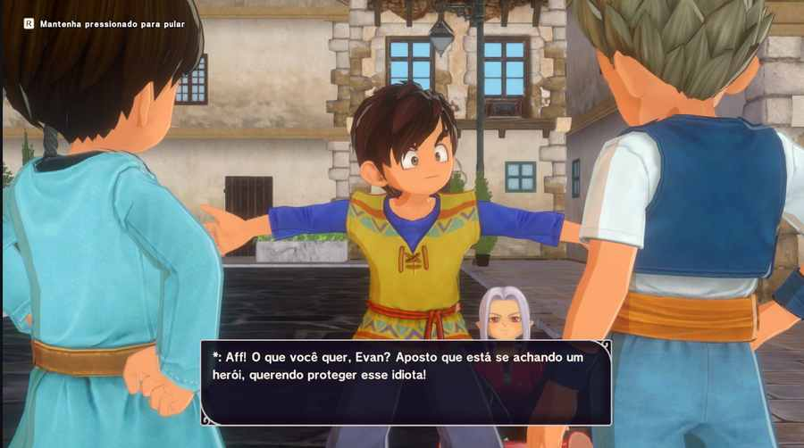
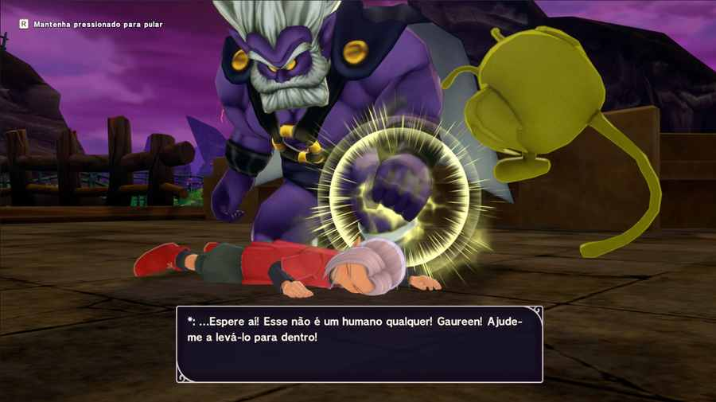
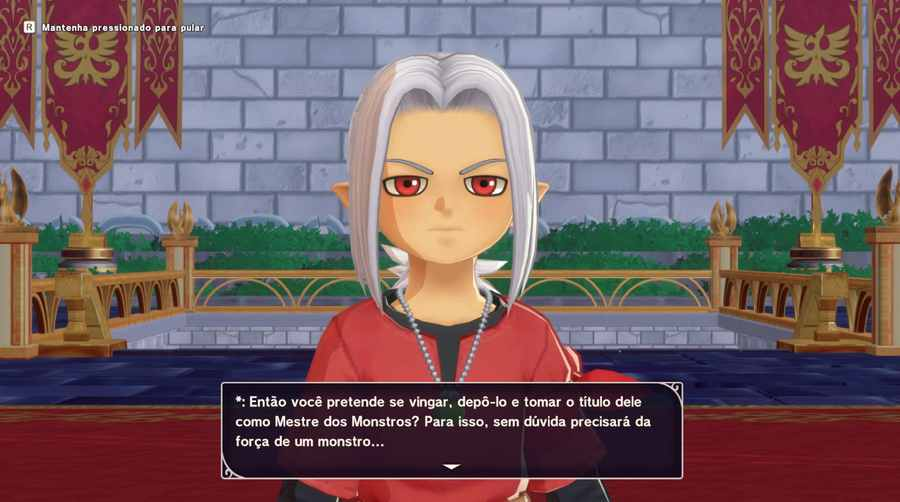

# Tradutor PT-BR v1.0 — Dragon Quest Monsters: The Dark Prince (PC)

Primeira versão do tradutor comunitário para português brasileiro da versão PC/Steam.

> **Projeto independente, gratuito e não oficial.** Não é afiliado, patrocinado, aprovado ou endossado pela Square Enix. Não possuímos autorização ou licença oficial da Square Enix para esta tradução ou para a distribuição do arquivo de dados modificado.

## Aviso sobre conteúdo e direitos

O pacote do tradutor contém **um único arquivo de dados de localização do jogo**, modificado para incorporar textos em português brasileiro. Na instalação, somente esse arquivo é substituído; o usuário deve guardar uma cópia do original para poder restaurá-lo.

Este pacote **não contém o jogo completo, o executável do jogo nem a estrutura completa de instalação**. É necessário possuir sua própria cópia de DRAGON QUEST MONSTERS: The Dark Prince para PC/Steam.

O arquivo de localização é um recurso técnico derivado do jogo e mantém a estrutura necessária para ser lido por ele. Portanto, não é um arquivo independente de legendas criado do zero. Os direitos sobre o jogo e seus elementos originais permanecem com seus respectivos titulares.

A tradução é disponibilizada gratuitamente e sem finalidade comercial. **A gratuidade, o escopo limitado a um único arquivo e este aviso de independência não significam autorização dos titulares nem eliminam, por si só, eventuais questões de direitos autorais.** O projeto não deve ser confundido com uma tradução oficial ou licenciada. O responsável reavaliará a disponibilização diante de eventual solicitação dos titulares dos direitos.

## Download

O pacote público **Tradutor PT-BR v1.0** será disponibilizado na página [Releases](https://github.com/gamespt-br/DQM3-PTBR-PC/releases).

O arquivo distribuído será `DQM3_PTBR_Tradutor_v1.0.zip`. Ele contém somente:
- o arquivo de dados de localização modificado;
- `LEIA-ME.txt`, com as instruções de instalação e restauração;
- `SHA256SUMS.txt`, com o hash para conferência de integridade.

Não será distribuída uma cópia do jogo.

## Como instalar

1. Baixe e extraia `DQM3_PTBR_Tradutor_v1.0.zip`.
2. Feche o jogo.
3. Na pasta de instalação do jogo pela Steam, abra `DQMonsters3_Data\\StreamingAssets\\AB`.
4. Faça uma cópia do arquivo original que tem o mesmo nome do arquivo traduzido. Guarde essa cópia em outro local seguro.
5. Copie o arquivo de localização que veio no ZIP para a pasta `AB` e confirme a substituição.
6. Ao iniciar um **jogo novo**, escolha **Espanhol (Español)** na tela de idioma. Essa escolha é obrigatória para a tradução funcionar.

Para restaurar o original, feche o jogo e copie o backup original de volta para a pasta `AB`, confirmando a substituição do arquivo traduzido.

As instruções completas também estão em [Instalação](docs/INSTALACAO.md) e no `LEIA-ME.txt` incluído no ZIP.

## Imagens do jogo traduzido

### Tutorial de combate

### Informações do monstro

### Diálogo com Moncho

### Diálogo com Gaureen

### Diálogo da campanha

### Menu de grupo

### Diálogo com Royston

## Compatibilidade

Esta primeira versão foi preparada para a versão de PC testada pelo responsável do projeto. Atualizações futuras do jogo podem exigir uma nova versão. Não use o arquivo em versões diferentes sem antes conferir a compatibilidade.

## Créditos

DRAGON QUEST MONSTERS: The Dark Prince é uma obra de seus respectivos titulares. Os nomes, marcas e elementos originais são mencionados apenas para identificar o jogo compatível com este projeto comunitário.
