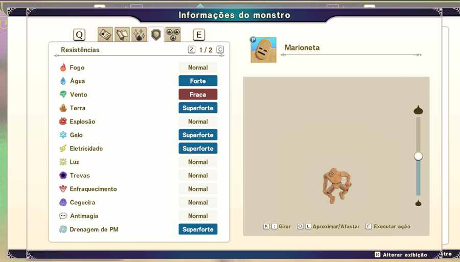

# Tradutor PT-BR v1.0 — Dragon Quest Monsters: The Dark Prince (PC)

Primeira versão do tradutor comunitário para português brasileiro da versão PC/Steam, preparada para a instalação testada pelo responsável do projeto.

> **Projeto independente, gratuito e não oficial.** Não é afiliado, patrocinado, aprovado ou endossado pela Square Enix. Não possuímos autorização ou licença oficial da Square Enix para esta tradução ou para a distribuição do patch.

## Aviso sobre conteúdo e direitos

O pacote usa um **patch diferencial** para aplicar localmente alterações em um arquivo de dados de localização do jogo já instalado pelo usuário. Ele não inclui o bundle traduzido completo, o executável do jogo ou a estrutura completa da instalação. É necessário possuir sua própria cópia de DRAGON QUEST MONSTERS: The Dark Prince para PC/Steam.

O patch contém alterações derivadas de recursos de localização do jogo. A distribuição diferencial reduz o conteúdo original incluído no pacote, mas **não significa autorização dos titulares nem elimina, por si só, eventuais questões de direitos autorais**. Os direitos sobre o jogo e seus elementos originais permanecem com seus respectivos titulares. O projeto não deve ser confundido com uma tradução oficial ou licenciada. O responsável reavaliará a disponibilização diante de eventual solicitação dos titulares dos direitos.

## Download

Após a validação funcional final em Windows, o pacote **Tradutor PT-BR v1.0** ficará na página [Releases](https://github.com/gamespt-br/DQM3-PTBR-PC/releases).

O ZIP diferencial será composto por:
- `Instalar_PTBR.cmd` e `Restaurar_PTBR.cmd`;
- `DQM3_PTBR_Installer.exe`, programa auxiliar autônomo para Windows x64;
- `patch.json`, com as alterações diferenciais;
- `LEIA-ME.txt` e `SHA256SUMS.txt`.

O pacote não contém o bundle traduzido completo, uma cópia do jogo ou o executável do jogo. O ZIP de distribuição não será armazenado no histórico Git do repositório.

## Como instalar

1. Baixe e extraia o ZIP para uma pasta do Windows.
2. Feche o jogo.
3. Execute `Instalar_PTBR.cmd`.
4. O instalador tentará localizar a instalação Steam automaticamente. Se não encontrar, selecione a pasta que contém `DQMonsters3.exe` e `DQMonsters3_Data`.
5. Confira o caminho e digite `INSTALAR` para confirmar.
6. O instalador verifica se o bundle local corresponde exatamente à base suportada e, então, aplica o patch diferencial.
7. Ao iniciar um **jogo novo**, escolha **Espanhol (Español)** na tela de idioma. Essa escolha é obrigatória para a tradução funcionar.

Python e bibliotecas externas não são necessários. O pacote é destinado ao Windows 10/11 de 64 bits.

O backup original e o manifesto ficam em `Documentos\\DQM3_PTBR_Backups`. Não apague esses arquivos enquanto puder precisar restaurar a instalação.

## Restaurar a instalação original

1. Feche o jogo.
2. Execute `Restaurar_PTBR.cmd`.
3. O restaurador localiza o manifesto e o backup correspondentes à instalação.
4. Confira o resumo e digite `RESTAURAR` para confirmar.

O restaurador confere os hashes do backup e do arquivo instalado. Se o arquivo atual tiver sido alterado depois da instalação — por exemplo, por uma atualização do jogo — a restauração é interrompida para evitar sobrescrever dados diferentes. Ele também reconhece os manifestos do pacote v1.0 anterior que substituía o bundle completo.

## Imagens do jogo traduzido

### Tutorial de combate

### Informações do monstro

### Diálogo com Moncho

### Diálogo com Gaureen

### Diálogo da campanha

### Menu de grupo

### Diálogo com Royston

## Compatibilidade

O patch exige exatamente o bundle-base cujo SHA-256 é:

`31e716932ab95479be1e1a4b212891f032caefb3fd8dfb39f4d56ae9b115081a`

A base foi associada à BuildID de referência `20285966`. Se o bundle for diferente, a instalação é interrompida sem substituí-lo. Atualizações futuras do jogo podem exigir uma nova versão do tradutor.

O programa auxiliar é comunitário e não possui assinatura digital; o Windows pode exibir um aviso de editor desconhecido. Execute-o somente se tiver obtido o pacote de uma fonte em que confia. Não desative as proteções do Windows.

## Créditos

DRAGON QUEST MONSTERS: The Dark Prince é uma obra de seus respectivos titulares. Os nomes, marcas e elementos originais são mencionados apenas para identificar o jogo compatível com este projeto comunitário.
