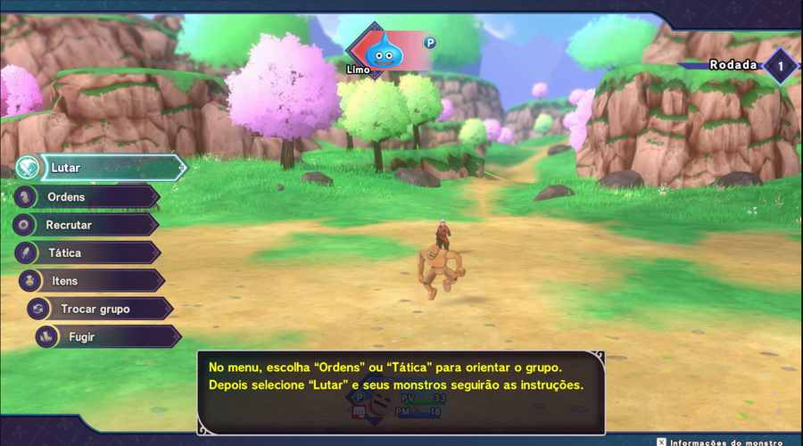

# Dragon Quest Monsters: The Dark Prince — Tradução PT-BR (PC)

Projeto comunitário e não oficial de localização para português brasileiro da versão PC/Steam.

> **Não afiliado, endossado ou patrocinado pela Square Enix.** Dragon Quest Monsters: The Dark Prince, seus personagens e marcas pertencem aos respectivos titulares.

## Galeria — capturas reais do jogo traduzido

As imagens são capturas fornecidas pelo responsável pelo projeto durante a execução do jogo com a tradução PT-BR ativa. Foram apenas otimizadas para publicação; os textos exibidos não foram substituídos ou editados.

### Tutorial de combate

### Informações do monstro

### Diálogo com Moncho

### Diálogo com Gaureen

### Diálogo sobre o título de Mestre dos Monstros

### Menu de grupo e tutorial

### Diálogo com Royston

## Escopo do projeto

- Tradução PT-BR para a versão PC/Steam.
- Pacote de trabalho confirmado pelo responsável: **Atualização 13**.
- Campanha principal e textos identificados das três DLCs contemplados no pacote testado pelo responsável.
- Os 533 nomes dos monstros foram mantidos no original, conforme a decisão de localização do projeto.

## Compatibilidade e distribuição

A tradução foi testada e confirmada pelo responsável em sua própria instalação Steam para PC. Isso não equivale a um teste independente em todas as configurações e não garante compatibilidade após futuras atualizações oficiais do jogo.

**O instalador/patch público ainda não está sendo distribuído por este repositório.** Antes de publicar arquivos modificados do jogo, o projeto passará por uma revisão do método de distribuição para evitar incluir dados originais do jogo desnecessariamente.

## Como acompanhar

Consulte [CHANGELOG.md](CHANGELOG.md) para o histórico e [CONTRIBUTING.md](CONTRIBUTING.md) para orientações de contribuição.

## Aviso

Este é um projeto de fãs, gratuito e sem fins comerciais. Não inclui executáveis, bibliotecas, bundles ou outros arquivos originais do jogo.
