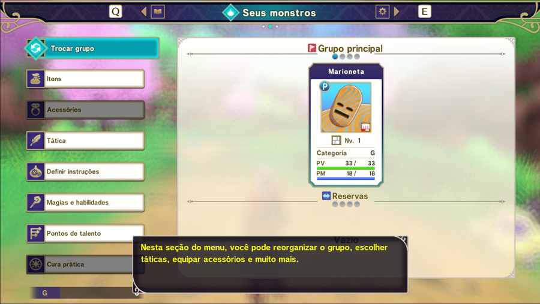

# Tradutor PT-BR v1.0 — Dragon Quest Monsters: The Dark Prince (PC)

Primeira versão do tradutor comunitário para português brasileiro da versão PC/Steam.

> Projeto não oficial, sem vínculo ou endosso da Square Enix.

## Download

O pacote público de instalação ainda não está disponível nesta página. Estamos preparando uma versão que aplique a tradução aos arquivos do jogo já instalados no computador, sem incluir uma cópia do bundle original do jogo.

Quando estiver pronta, a versão para download ficará na página [Releases](https://github.com/gamespt-br/DQM3-PTBR-PC/releases).

## Como instalar

Quando você tiver o pacote Tradutor PT-BR v1.0:

1. Extraia todo o conteúdo do ZIP para uma pasta.
2. Feche o jogo.
3. Execute `Instalar_PTBR.cmd`. Não abra o arquivo `.ps1` diretamente.
4. Aguarde a busca automática. Se o jogo não for encontrado, selecione a pasta que contém `DQMonsters3.exe` e `DQMonsters3_Data`.
5. Confira o caminho e digite `INSTALAR`.
6. Ao iniciar um **jogo novo**, escolha **Espanhol (Español)** na tela de idioma. Essa escolha é obrigatória para a tradução funcionar.

O instalador faz backup do arquivo original. Para desfazer a instalação, execute `Restaurar_PTBR.cmd` e selecione o manifesto correspondente.

## Imagens do jogo traduzido

### Tutorial de combate

### Informações do monstro

### Diálogo com Moncho

### Diálogo com Gaureen

### Diálogo da campanha

### Menu de grupo

### Diálogo com Royston

## Compatibilidade

Esta primeira versão foi preparada para a versão de PC testada pelo responsável do projeto. Atualizações futuras do jogo podem exigir uma nova versão.
